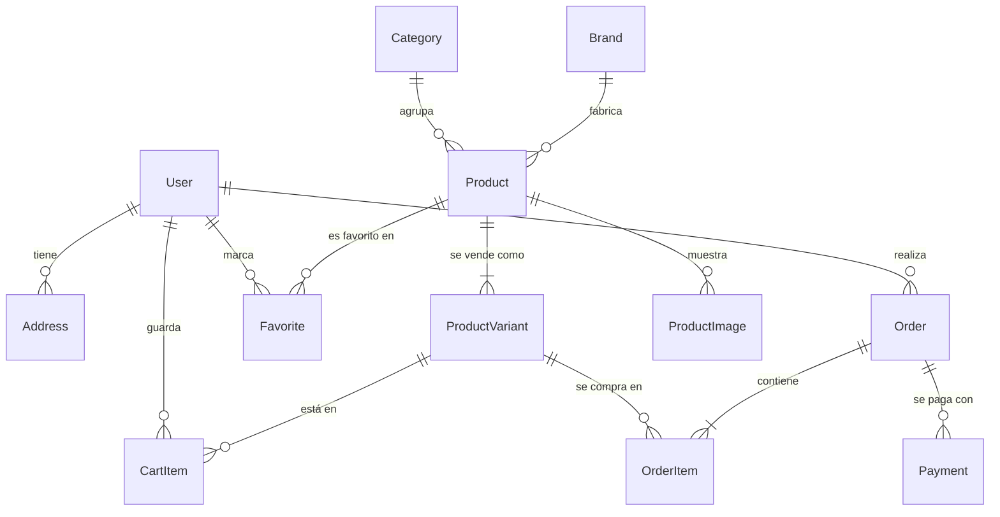
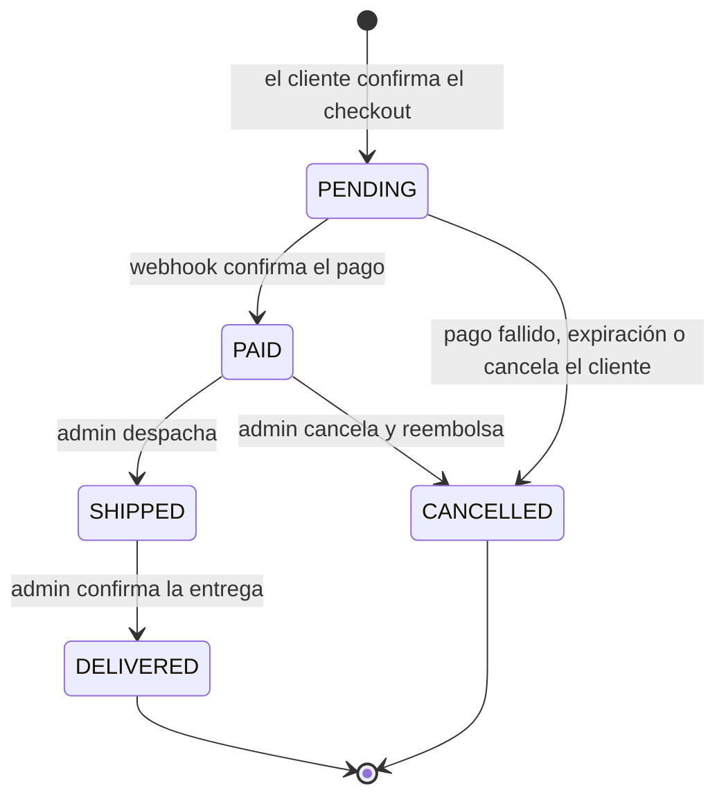
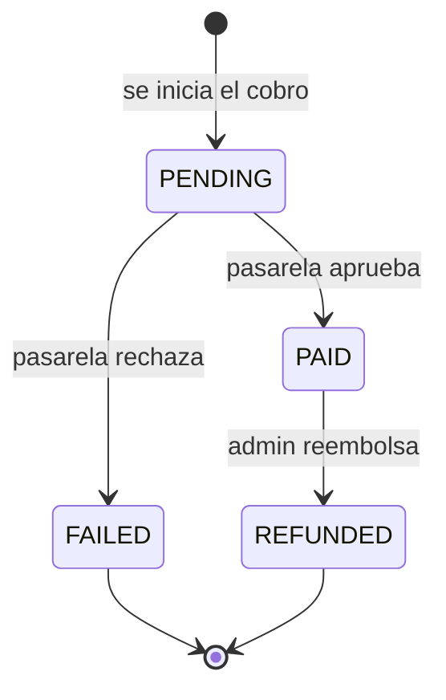

# Modelo de datos (borrador)

Derivado de los tipos en `src/lib/mock-*.ts`. El esquema de la sección 3 ya está implementado en `prisma/schema.prisma` (Prisma 7.10.0 en versión exacta, generador `prisma-client` con salida en `src/generated/prisma`, conexión en `prisma.config.ts`). Si se cambia uno, hay que cambiar el otro. La migración inicial está en `prisma/migrations/20261009000000_init/` y añade `CHECK` (stock, precios, cantidades e importes no negativos) que Prisma no expresa en el esquema.

Contenido: 1. Decisiones · 2. Diagrama de relaciones · 3. Esquema Prisma · 4. Descripción de los modelos · 5. Roles y permisos · 6. Flujos de estados · 7. API routes · 8. Cambios respecto al mock · 9. Alcance y pendientes.

## 1. Decisiones

- **Dinero en centavos (`Int`)**, nunca decimales. `formatPrice` divide por 100.
- **Specs como `Json`** en `Product`: cada categoría tiene claves distintas (RAM, Tamaño, DPI...) y `Category.filterKeys` dice cuáles se ofrecen como filtro. Alternativa más rígida: tabla `ProductSpec` (clave/valor) con índice, mejor para filtrar a gran escala.
- **Variantes**: todo producto tiene al menos una `ProductVariant`. Precio y stock viven en la variante; carrito y pedidos apuntan a ella.
- **El pedido guarda una copia** del precio, el nombre, el SKU y la dirección de envío, para que cambiar el catálogo o la dirección no altere pedidos pasados.
- **Pago separado del pedido**: un pedido puede tener varios intentos de pago (fallido, luego pagado).
- **Borrado lógico** de productos (`archivedAt`): borrarlos rompería `OrderItem`.
- **El servidor es la fuente de verdad**: precios, stock y totales se recalculan en el servidor al crear el pedido. Nunca se confía en lo que envía el cliente.

## 2. Diagrama de relaciones



Lectura: `||--o{` es «uno a cero o muchos», `||--|{` es «uno a uno o muchos». `Favorite` y `CartItem` son tablas puente con clave compuesta.

## 3. Esquema Prisma

```prisma
enum Role {
  CUSTOMER
  ADMIN
}

enum UserStatus {
  ACTIVE
  BLOCKED
}

enum OrderStatus {
  PENDING    // creado, sin pago confirmado
  PAID
  SHIPPED
  DELIVERED
  CANCELLED
}

enum PaymentStatus {
  PENDING
  PAID
  FAILED
  REFUNDED
}

enum PaymentMethod {
  CARD // única en la primera versión; TRANSFER y CASH se añaden con una migración
}

// Campos base de Better Auth (id, name, email, emailVerified, image, createdAt, updatedAt) más los propios.
// La contraseña no vive aquí: Better Auth guarda su hash en Account.password (providerId "credential").
model User {
  id            String     @id @default(cuid())
  email         String     @unique
  name          String
  emailVerified Boolean    @default(false)
  image         String?
  phone         String?
  role          Role       @default(CUSTOMER)
  status        UserStatus @default(ACTIVE)
  createdAt     DateTime   @default(now())
  updatedAt     DateTime   @updatedAt

  sessions  Session[]
  accounts  Account[]
  addresses Address[]
  orders    Order[]
  favorites Favorite[]
  cart      CartItem[]
}

// Sesión de Better Auth. El token viaja en una cookie httpOnly.
model Session {
  id        String   @id @default(cuid())
  token     String   @unique
  expiresAt DateTime
  ipAddress String?
  userAgent String?
  userId    String
  createdAt DateTime @default(now())
  updatedAt DateTime @updatedAt

  user User @relation(fields: [userId], references: [id], onDelete: Cascade)

  @@index([userId])
}

// Método de acceso de un usuario. Con email y contraseña: providerId "credential" y el hash en password.
model Account {
  id                    String    @id @default(cuid())
  accountId             String
  providerId            String
  userId                String
  accessToken           String?
  refreshToken          String?
  idToken               String?
  accessTokenExpiresAt  DateTime?
  refreshTokenExpiresAt DateTime?
  scope                 String?
  password              String?
  createdAt             DateTime  @default(now())
  updatedAt             DateTime  @updatedAt

  user User @relation(fields: [userId], references: [id], onDelete: Cascade)

  @@index([userId])
}

// Tokens de un solo uso de Better Auth (verificación de email, recuperación de contraseña).
model Verification {
  id         String   @id @default(cuid())
  identifier String
  value      String
  expiresAt  DateTime
  createdAt  DateTime @default(now())
  updatedAt  DateTime @updatedAt

  @@index([identifier])
}

model Address {
  id        String  @id @default(cuid())
  userId    String
  user      User    @relation(fields: [userId], references: [id], onDelete: Cascade)
  label     String? // "Casa", "Trabajo"
  line1     String
  city      String
  zip       String
  isDefault Boolean @default(false)

  @@index([userId])
}

model Category {
  id          String    @id @default(cuid())
  slug        String    @unique // pc, monitores, teclados, mouses, audio, componentes
  name        String
  description String
  filterKeys  String[] // claves de Product.specs usadas como filtros
  products    Product[]
}

model Brand {
  id       String    @id @default(cuid())
  slug     String    @unique
  name     String    @unique
  products Product[]
}

model Product {
  id          String    @id @default(cuid())
  slug        String    @unique
  name        String
  description String?
  popularity  Int       @default(0)
  isNew       Boolean   @default(false)
  specs       Json      // { "RAM": "16 GB", ... } comunes a todas las variantes
  categoryId  String
  brandId     String
  archivedAt  DateTime?
  createdAt   DateTime  @default(now())

  category  Category         @relation(fields: [categoryId], references: [id])
  brand     Brand            @relation(fields: [brandId], references: [id])
  variants  ProductVariant[]
  images    ProductImage[]
  favorites Favorite[]

  @@index([categoryId, brandId])
}

// Todo producto tiene al menos una variante; la que no varía lleva options = {}.
model ProductVariant {
  id         String  @id @default(cuid())
  productId  String
  sku        String  @unique
  options    Json    // { "Color": "Negro", "Capacidad": "1 TB" }
  priceCents Int
  stock      Int     @default(0)
  isDefault  Boolean @default(false)

  product    Product     @relation(fields: [productId], references: [id], onDelete: Cascade)
  cartItems  CartItem[]
  orderItems OrderItem[]

  @@index([productId])
  @@index([priceCents])
}

model ProductImage {
  id        String  @id @default(cuid())
  productId String
  product   Product @relation(fields: [productId], references: [id], onDelete: Cascade)
  url       String
  alt       String?
  position  Int     @default(0)

  @@index([productId])
}

model Favorite {
  userId    String
  productId String
  createdAt DateTime @default(now())

  user    User    @relation(fields: [userId], references: [id], onDelete: Cascade)
  product Product @relation(fields: [productId], references: [id], onDelete: Cascade)

  @@id([userId, productId])
}

model CartItem {
  userId    String
  variantId String
  quantity  Int

  user    User           @relation(fields: [userId], references: [id], onDelete: Cascade)
  variant ProductVariant @relation(fields: [variantId], references: [id], onDelete: Cascade)

  @@id([userId, variantId])
}

model Order {
  id            String      @id @default(cuid())
  number        String      @unique // legible, ej. A1B2C3D4
  userId        String
  status        OrderStatus @default(PENDING)
  subtotalCents Int
  shippingCents Int
  totalCents    Int
  // copia de la dirección al momento de comprar
  shipName      String
  shipLine1     String
  shipCity      String
  shipZip       String
  shipPhone     String?
  createdAt     DateTime    @default(now())

  user     User        @relation(fields: [userId], references: [id], onDelete: Restrict)
  items    OrderItem[]
  payments Payment[]

  @@index([userId])
  @@index([status, createdAt])
}

model OrderItem {
  id             String @id @default(cuid())
  orderId        String
  variantId      String
  nameSnapshot   String // producto + opciones, ej. "SSD NVMe - 1 TB"
  skuSnapshot    String
  unitPriceCents Int
  quantity       Int

  order   Order          @relation(fields: [orderId], references: [id], onDelete: Cascade)
  variant ProductVariant @relation(fields: [variantId], references: [id])

  @@index([orderId])
}

model Payment {
  id          String        @id @default(cuid())
  orderId     String
  method      PaymentMethod
  status      PaymentStatus @default(PENDING)
  amountCents Int
  providerRef String?       @unique // id en la pasarela, para el webhook
  createdAt   DateTime      @default(now())

  order Order @relation(fields: [orderId], references: [id], onDelete: Restrict)

  @@index([orderId])
  @@index([status])
}
```

Cambio respecto al borrador anterior: la autenticación usa Better Auth (migración `20261011043410_better_auth`). `User.passwordHash` desaparece: el hash scrypt vive en `Account.password` (providerId `credential`), y se añaden `Session`, `Account` y `Verification`, que son las tablas que exige la librería. `User` suma `emailVerified`, `image` y `updatedAt`.

## 4. Descripción de los modelos

### User
Persona con cuenta. Cliente o administrador.

| Campo | Tipo | Descripción |
| --- | --- | --- |
| `id` | `String` (cuid) | Identificador. |
| `email` | `String`, único | Usuario de acceso. Guardar en minúsculas. |
| `name` | `String` | Nombre para mostrar y para el envío. |
| `phone` | `String?` | Teléfono de contacto. |
| `emailVerified`, `image` | `Boolean`, `String?` | Campos base de Better Auth. Sin verificación de email por ahora. |
| `role` | `Role` | `CUSTOMER` (por defecto) o `ADMIN`. |
| `status` | `UserStatus` | `ACTIVE` o `BLOCKED`. Un usuario bloqueado no puede iniciar sesión ni comprar. |
| `createdAt` | `DateTime` | Fecha de alta. |

### Address
Dirección de envío guardada. Un usuario puede tener varias.

| Campo | Tipo | Descripción |
| --- | --- | --- |
| `userId` | `String` | Dueño. Se borra con el usuario. |
| `label` | `String?` | Nombre corto («Casa», «Trabajo»). |
| `line1`, `city`, `zip` | `String` | Calle y número, ciudad y código postal. |
| `isDefault` | `Boolean` | Dirección precargada en el checkout. Solo una por usuario (lo garantiza la lógica, no la base). |

### Category
Una de las seis categorías de la tienda.

| Campo | Tipo | Descripción |
| --- | --- | --- |
| `slug` | `String`, único | Va en la URL: `/categoria/[slug]`. |
| `name`, `description` | `String` | Textos de la interfaz. |
| `filterKeys` | `String[]` | Claves de `Product.specs` que se ofrecen como filtro en esa categoría. |

### Brand
Fabricante. Hoy es texto en el mock; pasa a tabla para filtrar y evitar variantes de escritura.

| Campo | Tipo | Descripción |
| --- | --- | --- |
| `slug`, `name` | `String`, únicos | Identificador de URL y nombre visible. |

### Product
Ficha de catálogo. No tiene precio ni stock: eso es de cada variante.

| Campo | Tipo | Descripción |
| --- | --- | --- |
| `slug` | `String`, único | Va en la URL: `/producto/[slug]`. |
| `name`, `description` | `String`, `String?` | Nombre y texto largo. |
| `popularity` | `Int` | Puntaje para ordenar por «más vendidos». Se actualiza al confirmar pedidos. |
| `isNew` | `Boolean` | Marca «Nuevo» y alimenta «Recién llegados». |
| `specs` | `Json` | Mapa de especificaciones comunes a todas las variantes. |
| `categoryId`, `brandId` | `String` | Relaciones. |
| `archivedAt` | `DateTime?` | Si tiene fecha, el producto no se muestra ni se vende. Es el «eliminar» del admin. |

### ProductVariant
Unidad que se compra. Un producto sin opciones tiene una sola variante con `options = {}`.

| Campo | Tipo | Descripción |
| --- | --- | --- |
| `sku` | `String`, único | Código de inventario. |
| `options` | `Json` | Opciones que la distinguen (`{ "Color": "Negro" }`). |
| `priceCents` | `Int` | Precio en centavos de dólar. |
| `stock` | `Int` | Unidades disponibles. Nunca negativo (lo comprueba la lógica y, si se puede, una restricción `CHECK`). |
| `isDefault` | `Boolean` | Variante preseleccionada y cuyo precio se muestra en el listado. |

### ProductImage
Foto del producto. Hoy hay íconos de marcador.

| Campo | Tipo | Descripción |
| --- | --- | --- |
| `url`, `alt` | `String`, `String?` | Ruta de la imagen y texto alternativo. |
| `position` | `Int` | Orden en la galería; la primera es la portada. |

### Favorite
Producto marcado por un usuario. Clave compuesta `(userId, productId)`, así que no se repite.

### CartItem
Línea del carrito persistente de un usuario con sesión. Clave compuesta `(userId, variantId)`. El carrito de invitado sigue en `localStorage` y se fusiona al iniciar sesión.

| Campo | Tipo | Descripción |
| --- | --- | --- |
| `variantId` | `String` | Variante elegida. |
| `quantity` | `Int` | Entre 1 y el stock de la variante. |

### Order
Compra confirmada por el cliente. Los totales y la dirección son una copia fija.

| Campo | Tipo | Descripción |
| --- | --- | --- |
| `number` | `String`, único | Código legible que ve el cliente (`A1B2C3D4`). |
| `userId` | `String` | Comprador. No se puede borrar un usuario con pedidos (`Restrict`). |
| `status` | `OrderStatus` | Ver flujo en la sección 6. |
| `subtotalCents`, `shippingCents`, `totalCents` | `Int` | Importes. El envío es US$15, gratis desde US$500 de subtotal (regla de `cart.ts`). `totalCents = subtotal + envío`. |
| `shipName`, `shipLine1`, `shipCity`, `shipZip`, `shipPhone` | `String` | Copia de la dirección elegida. |
| `createdAt` | `DateTime` | Fecha del pedido. |

### OrderItem
Línea de un pedido, con los datos congelados al comprar.

| Campo | Tipo | Descripción |
| --- | --- | --- |
| `variantId` | `String` | Variante comprada (referencia, no se usa para mostrar). |
| `nameSnapshot`, `skuSnapshot` | `String` | Nombre y SKU al momento de comprar. |
| `unitPriceCents` | `Int` | Precio unitario cobrado. |
| `quantity` | `Int` | Unidades. |

### Payment
Intento de cobro de un pedido.

| Campo | Tipo | Descripción |
| --- | --- | --- |
| `method` | `PaymentMethod` | Hoy solo `CARD`. |
| `status` | `PaymentStatus` | Ver flujo en la sección 6. |
| `amountCents` | `Int` | Importe del intento. Debe coincidir con `Order.totalCents`. |
| `providerRef` | `String?`, único | Id del cobro en la pasarela. La unicidad hace idempotente el webhook. |

## 5. Roles y permisos

Tres actores: visitante (sin sesión), cliente (`CUSTOMER`) y administrador (`ADMIN`). Un usuario `BLOCKED` no puede iniciar sesión; si ya tenía sesión, el servidor la rechaza al comprobar el estado.

Reglas generales: la autorización se comprueba en el servidor en cada petición, no solo la autenticación. «Propio» significa que el recurso pertenece al usuario de la sesión, y se filtra por `userId` en la consulta, no después.

| Recurso / acción | Visitante | Cliente | Admin |
| --- | :---: | :---: | :---: |
| Ver catálogo (categorías, productos activos, variantes) | Sí | Sí | Sí |
| Ver productos archivados | No | No | Sí |
| Crear, editar, archivar productos y variantes | No | No | Sí |
| Registrarse e iniciar sesión | Sí | — | — |
| Ver y editar su perfil y direcciones | No | Propio | Propio |
| Carrito persistente | No (usa `localStorage`) | Propio | Propio |
| Favoritos | No (usa `localStorage`) | Propios | Propios |
| Crear pedido | No | Sí | Sí |
| Ver pedidos | No | Propios | Todos |
| Cancelar pedido | No | Propio, solo en `PENDING` | Cualquiera, según el flujo |
| Cambiar estado de envío (`SHIPPED`, `DELIVERED`) | No | No | Sí |
| Ver pagos | No | Los de sus pedidos | Todos |
| Reembolsar | No | No | Sí |
| Ver y buscar usuarios | No | No | Sí |
| Bloquear usuario o cambiar rol | No | No | Sí, nunca sobre sí mismo |
| Webhook de la pasarela | Solo con firma válida | — | — |

Restricciones que se mantienen aunque el admin las pida:
- Un admin no puede quitarse el rol ni bloquearse a sí mismo, para no dejar la tienda sin administrador.
- Los datos de `Payment` nunca incluyen datos de tarjeta: no se piden ni se guardan.
- El hash de la contraseña (`Account.password`) no sale en ninguna respuesta (lo comprueba `tests/api/auth.api.test.ts`).

## 6. Flujos de estados

### Pedido (`OrderStatus`)



| De | A | Quién | Efecto |
| --- | --- | --- | --- |
| — | `PENDING` | Cliente | Se crea el pedido y sus líneas con precios recalculados en el servidor. |
| `PENDING` | `PAID` | Webhook | El `Payment` pasa a `PAID`. Sube `Product.popularity`. |
| `PENDING` | `CANCELLED` | Cliente, sistema | Si falla el pago o pasa el plazo sin pagar. Devuelve el stock reservado. |
| `PAID` | `SHIPPED` | Admin | Notifica al cliente. |
| `PAID` | `CANCELLED` | Admin | Dispara el reembolso: `Payment` a `REFUNDED`. Devuelve el stock. |
| `SHIPPED` | `DELIVERED` | Admin | Cierra el pedido. |

Cualquier otra transición se rechaza. Desde `DELIVERED` y `CANCELLED` no se sale. Un envío ya despachado no se cancela por esta vía (se gestiona como devolución, fuera de la primera versión). La regla vive en una función pura `canTransition(from, to)` en `src/lib/orders.ts`, con su test.

### Pago (`PaymentStatus`)



- Un pedido en `PENDING` puede acumular varios `Payment`: uno `FAILED` y un reintento que termina `PAID`.
- El pedido pasa a `PAID` cuando existe un `Payment` en `PAID` por el total. Si llega un segundo cobro aprobado para el mismo pedido, se marca para reembolso y se avisa al admin.
- El webhook es idempotente: se busca por `providerRef` y, si ya está en el estado final, no hace nada.

### Stock (pendiente de decidir)

Propuesta: descontar `ProductVariant.stock` al crear el pedido (`PENDING`), dentro de la misma transacción que lo crea y con `UPDATE ... WHERE stock >= cantidad`, para que dos compras simultáneas no vendan la última unidad. Se devuelve al pasar a `CANCELLED`. Necesita un trabajo programado que cancele pedidos `PENDING` sin pago pasado cierto plazo.

## 7. Estructura de API routes

Convenciones de Next.js 16 (App Router): cada endpoint es un `route.ts` con funciones `GET`, `POST`, `PATCH`, `DELETE`. Los parámetros dinámicos llegan como `Promise` (`ctx.params`, tipado con `RouteContext<'/ruta/[id]'>`). Los tipos se generan con `next dev`, `next build` o `next typegen`.

**Lectura pública del catálogo**: las páginas son Server Components y consultan Prisma directamente, sin pasar por la API. Las rutas de `/api/products` y similares solo hacen falta si algo del cliente necesita pedir datos (por ejemplo, el buscador con sugerencias).

**Escrituras de la propia interfaz** (favoritos, carrito, perfil, admin) van **siempre** por estas rutas, nunca por Server Actions (regla de `plan.md` §11). El webhook y Auth.js también son rutas.

```
src/app/api/
├─ auth/
│  └─ [...all]/route.ts             GET, POST     Better Auth: sign-up/email, sign-in/email, sign-out, get-session
├─ register/route.ts                POST          Alta de cliente
├─ me/
│  ├─ route.ts                      GET, PATCH    Perfil propio
│  ├─ addresses/
│  │  ├─ route.ts                   GET, POST     Direcciones propias
│  │  └─ [id]/route.ts              PATCH, DELETE
│  ├─ cart/
│  │  ├─ route.ts                   GET, PUT, DELETE   Ver, fusionar carrito de invitado, vaciar
│  │  └─ items/[variantId]/route.ts PUT, DELETE        Fijar cantidad, quitar línea
│  └─ favorites/
│     ├─ route.ts                   GET
│     └─ [productId]/route.ts       PUT, DELETE
├─ products/
│  ├─ route.ts                      GET           Listado con filtros, orden y paginación
│  └─ [slug]/route.ts               GET           Detalle con variantes e imágenes
├─ categories/route.ts              GET
├─ orders/
│  ├─ route.ts                      GET, POST     Mis pedidos / crear pedido desde el carrito
│  └─ [number]/
│     ├─ route.ts                   GET           Detalle de un pedido propio
│     ├─ cancel/route.ts            POST          Cancelar (solo PENDING)
│     └─ pay/route.ts               POST          Iniciar o reintentar el cobro con tarjeta
├─ webhooks/
│  └─ payments/route.ts             POST          Confirmación de la pasarela (firma obligatoria)
└─ admin/                           Todo exige rol ADMIN
   ├─ products/
   │  ├─ route.ts                   GET, POST
   │  └─ [id]/
   │     ├─ route.ts                GET, PATCH, DELETE   DELETE archiva (no borra)
   │     └─ variants/route.ts       POST
   ├─ variants/[id]/route.ts        PATCH, DELETE
   ├─ orders/
   │  ├─ route.ts                   GET           Todos, con filtro por estado
   │  └─ [number]/
   │     ├─ route.ts                GET
   │     └─ status/route.ts         POST          Transición (SHIPPED, DELIVERED, CANCELLED)
   ├─ payments/
   │  ├─ route.ts                   GET           Con filtro por estado y totales
   │  └─ [id]/refund/route.ts       POST
   └─ users/
      ├─ route.ts                   GET           Búsqueda y filtro por rol
      └─ [id]/route.ts              PATCH         Bloquear, desbloquear, cambiar rol
```

**Implementado (2026-10-10):** `GET /api/categories`, `GET /api/products` (listado o `?ids=`, máximo 50) y `GET /api/products/[slug]`, con `handler()` de `src/lib/api-handler.ts` y validación de `src/lib/catalog-api.ts`. El listado pagina con `pageSize` 12 por defecto y 48 como máximo. El resto de rutas sigue pendiente (dependen de la autenticación).

### Reglas comunes

- **Autorización en cada handler**: `requireUser()` y `requireAdmin()` (`src/lib/server/session.ts`) leen la sesión en el servidor y lanzan `UNAUTHENTICATED` (401) o `FORBIDDEN` (403). `src/proxy.ts` redirige `/admin` y `/cuenta` sin cookie como primera barrera, pero **no sustituye** la comprobación. En páginas se usa `requirePageAccess` en el layout **y en cada página**: Next renderiza la página por separado del layout, y una guarda solo en el layout deja salir su contenido.
- **Validación de entrada**: todo cuerpo, parámetro y query se valida con un esquema Zod (regla de `plan.md` §11; verificar la versión vigente antes de instalar). Se rechaza lo desconocido. Los mismos esquemas validan los formularios del cliente con react-hook-form, así cliente y servidor comparten las reglas.
- **Respuesta de error uniforme**: `{ "error": { "code": "STOCK_INSUFFICIENT", "message": "...", "details": ... } }`. Códigos y estados en la sección 7.1.
- **Paginación**: `GET /api/products?page=1&pageSize=24` devuelve `{ items, total, page, pageSize }`. Máximo de `pageSize` fijado en el servidor.
- **Filtros del catálogo**: `category`, `brand` (repetible), `minPrice`, `maxPrice`, `sort` (`popularity`, `price_asc`, `price_desc`, `name`) y las specs propias de la categoría como `spec.RAM=16 GB`. Se traducen a consultas Prisma en el servidor.
- **Dinero**: la API entrega y recibe centavos (`priceCents`). La conversión a dólares es solo de presentación.
- **Crear pedido (`POST /api/orders`)**: el cuerpo trae solo `addressId` (o la dirección). Las líneas salen del carrito guardado en el servidor, y precios, stock, envío y total se recalculan allí. Todo ocurre en una transacción.
- **Webhook**: se verifica la firma de la pasarela con el cuerpo crudo, se responde `200` rápido y se procesa de forma idempotente. Nunca se confía en importes enviados por el cliente.
- **Límite de peticiones** en login, registro y creación de pedidos.
- **Autenticación**: Better Auth 1.7 (`src/lib/auth.ts`) con email y contraseña. Se eligió en lugar de Auth.js porque la v5 de Auth.js seguía en beta y el proyecto pasó al equipo de Better Auth. Las sesiones van en la tabla `Session` con cookie `httpOnly`, `SameSite=Lax` y `secure` con HTTPS. `role` y `status` son campos del servidor (`input: false`). Un hook impide crear sesión a usuarios `BLOCKED`. Límite de 5 inicios de sesión y 3 registros por minuto y por IP.

### 7.1 Manejo de errores

Implementado en `src/lib/errors.ts` (con test): `AppError`, `ERROR_STATUS` y `toErrorResponse`.

**Dos categorías.** Los errores *esperados* (validación, sin stock, transición inválida) son de dominio: se lanzan como `AppError` con un código y un mensaje seguro de mostrar. Todo lo demás (base caída, bug) es *inesperado*: se registra completo en el servidor y el cliente solo recibe `INTERNAL` con un mensaje genérico. Nunca se envía `error.message` de un error desconocido, porque puede contener cadenas de conexión o consultas.

| Código | HTTP | Cuándo |
| --- | :---: | --- |
| `VALIDATION` | 400 | Cuerpo, parámetro o query no cumple el esquema. `details` lista los campos. |
| `UNAUTHENTICATED` | 401 | Sin sesión válida o usuario bloqueado. |
| `FORBIDDEN` | 403 | Sesión válida sin permiso (rol o recurso ajeno). |
| `NOT_FOUND` | 404 | No existe, o es de otro usuario (no se distingue, para no revelar existencia). |
| `STOCK_INSUFFICIENT` | 409 | Una variante no tiene unidades suficientes. `details` trae variante y disponibles. |
| `INVALID_TRANSITION` | 409 | Cambio de estado no permitido del pedido o del pago. |
| `CONFLICT` | 409 | Choque con el estado actual (email ya registrado, SKU repetido). |
| `BUSINESS_RULE` | 422 | Regla de negocio incumplida (carrito vacío, pedido ya pagado). |
| `RATE_LIMITED` | 429 | Demasiados intentos. |
| `INTERNAL` | 500 | Fallo no esperado. Sin detalles. |
| `EXTERNAL_SERVICE` | 502 | La pasarela no responde o falla. Sin `details`. |

**Patrón de cada handler.** Un envoltorio común captura lo lanzado, lo traduce con `toErrorResponse` y registra una sola vez los 5xx. Los 4xx no se registran como error (son tráfico normal) y nada se registra y se vuelve a lanzar.

```ts
export function handler(fn: (req: NextRequest, ctx: C) => Promise<Response>) {
  return async (req: NextRequest, ctx: C) => {
    try {
      return await fn(req, ctx);
    } catch (err) {
      const { status, body } = toErrorResponse(err);
      if (status >= 500) console.error(err); // sustituir por el logger elegido
      return Response.json(body, { status });
    }
  };
}
```

**Casos que exigen cuidado**
- **Crear pedido**: todo en una transacción de Prisma. Si falla cualquier línea (sin stock, variante archivada), se revierte entero y se responde `409` con la línea culpable. Nunca queda un pedido a medias ni stock descontado sin pedido.
- **Cobro (`pay`)**: si la pasarela falla o agota el tiempo, el `Payment` queda `FAILED` y el pedido sigue `PENDING`, para poder reintentar. Se responde `502` sin datos de la pasarela. Se usa un tiempo máximo de espera y no se reintenta solo (un reintento ciego puede cobrar dos veces).
- **Webhook**: firma inválida → `401` sin procesar. Evento repetido → `200` sin efecto (idempotencia por `providerRef`). Error propio al procesar → `500`, para que la pasarela reintente; el evento aún no se dio por recibido. Evento válido que no corresponde a ningún pedido → `200` y registro para revisión, porque reintentarlo no lo arregla.
- **Stock concurrente**: el descuento condicional (`WHERE stock >= cantidad`) devuelve 0 filas si otro pedido se adelantó; eso se traduce en `STOCK_INSUFFICIENT`, no en un error genérico.

**Interfaz**
- `error.tsx` en `(tienda)` y `admin` muestra un fallback con «Reintentar» (`retry()`; en esta versión de Next reemplaza al antiguo `reset`) y el `digest` para cruzarlo con los logs. `global-error.tsx` cubre el layout raíz con su propio `<html>`, sin estilos globales.
- `not-found.tsx` en ambas zonas atiende los `notFound()` de producto, categoría y edición de producto.
- Los formularios mostrarán el `message` de un `AppError` y el detalle por campo de `VALIDATION`. Un error `INTERNAL` o `502` muestra un aviso genérico, nunca el cuerpo crudo.

## 8. Cambios respecto al mock

- `Order.status` pasa de 3 a 5 estados (`PAID` y `CANCELLED` son nuevos): el admin ya distingue pagos pagados, fallidos y reembolsados.
- `Payment.customer` y `User.orderCount` del mock se calculan con joins, no se guardan.
- `Product.brand` y `category` dejan de ser texto y pasan a ser tablas.
- La dirección única de `demoUser` pasa a varias (`Address`).
- `price` y `stock` salen de `Product` y viven en `ProductVariant`.
- El mock guarda precios en dólares (`price`) y fechas como texto ISO; el esquema usa centavos y `DateTime`.

## 9. Alcance y pendientes

**Decidido**
- Acceso con email y contraseña (Better Auth). Sin Google, recuperación ni verificación de email por ahora.
- Hash de contraseñas: scrypt, el que trae Better Auth.
- Solo compra con cuenta.
- Pago solo con tarjeta por pasarela, confirmado por webhook.
- Con variantes de producto.
- Fuera de la primera versión: reseñas (el mock las tiene escritas a mano), cupones y seguimiento de envío.
- Escrituras del cliente por Route Handlers, no Server Actions (`plan.md` §11).

**Pendiente de decidir**
- **Pasarela concreta** (Mercado Pago, Stripe...): define `providerRef`, el webhook y el flujo de `pay`.
- **Precio de una variante en la tarjeta**: mostrar «desde US$X» (mínimo) o el de la variante por defecto.
- **Reserva de stock**: ¿al crear el pedido (propuesta de la sección 6) o al confirmar el pago?
- **Plazo de expiración** de un pedido `PENDING` sin pago.
